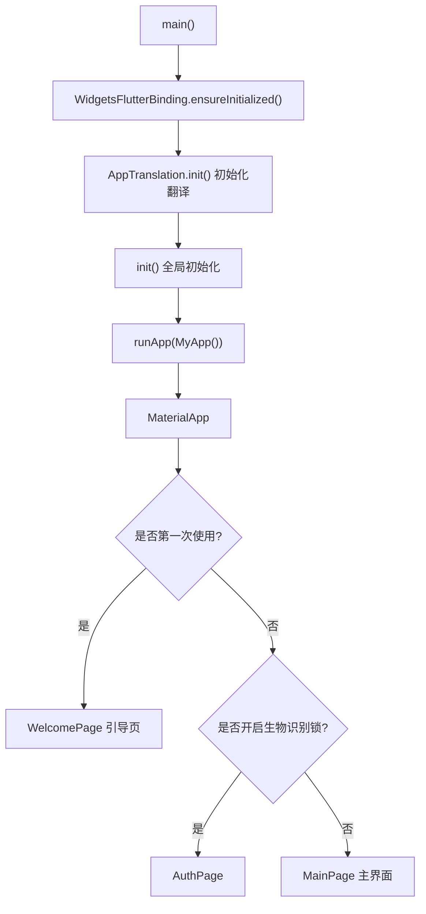
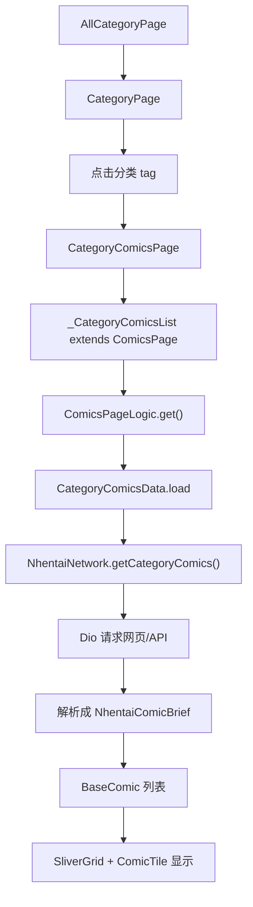

# PicaComic 项目架构学习指南

这份文档是给“完全不懂 Flutter，但想快速看懂这个项目”的学习者看的。目标不是把每一行代码都解释完，而是帮你建立一张地图：这个 App 从哪里启动，页面怎么跳转，漫画源怎么接入，网络数据怎么变成界面，阅读器和下载又是怎么工作的。

如果你只想最快理解项目，请先读前 6 节；如果你想开始改功能，再看后面的“常见改动入口”和“实战例子”。

## 1. 这个项目是什么

PicaComic 是一个 Flutter 写的多漫画源客户端。它支持多个内置漫画源，例如：

- `picacg`
- `ehentai`
- `jm`，也就是禁漫天堂
- `hitomi`
- `htmanga`
- `nhentai`

项目的核心思想是：不同网站/API 的数据格式不一样，但 App 页面希望用统一方式展示。所以项目定义了一套“漫画源接口”，每个漫画源只要把自己的分类、搜索、详情、阅读图片、收藏等能力接到这套接口上，页面层就可以复用同一套列表、详情页、搜索页、阅读器。

一句话理解：

```text
不同漫画网站/API
    ↓
各自的 network 模块负责请求和解析
    ↓
ComicSource 统一包装成 App 能懂的数据
    ↓
pages/components 统一展示
```

## 2. Flutter 新手先知道这几个概念

### Widget 是界面

Flutter 里几乎所有界面元素都是 `Widget`。按钮、文字、页面、列表、弹窗都是 Widget。

项目里常见写法：

```dart
class MainPage extends StatefulWidget { ... }
class CategoryPage extends StatelessWidget { ... }
```

- `StatelessWidget`：自身不保存会变化的状态，适合静态页面或依赖外部数据的页面。
- `StatefulWidget`：自己有状态，比如选中的 Tab、搜索框文字、加载状态。

### build 方法负责画界面

每个 Widget 最重要的方法通常是：

```dart
@override
Widget build(BuildContext context) {
  return ...;
}
```

你可以把 `build` 理解成“根据当前状态，把界面搭出来”。

### Future/async 是异步

网络请求、读文件、读数据库都需要等待，所以大量代码会写成：

```dart
Future<Res<List<BaseComic>>> getComics(int page) async {
  return await loader(...);
}
```

意思是：这个函数不会立刻返回真实结果，而是返回一个未来会完成的任务。

### Navigator 是页面跳转

Flutter 页面跳转通常通过 `Navigator.push`。这个项目封装了一层 `App.to`、`App.globalTo`、`context.to`，所以你会看到：

```dart
context.to(() => ComicPage(sourceKey: "jm", id: comic.id));
App.globalTo(() => ComicReadingPage(...));
```

可以简单理解为“打开新页面”。

## 3. 项目目录地图

根目录下有 Flutter 多平台工程文件：

```text
android/        Android 原生工程和打包配置
ios/            iOS 工程
windows/        Windows 工程
linux/          Linux 工程
macos/          macOS 工程
web/            Web 工程
assets/         JSON、初始化脚本等资源
images/         图标、头像等图片资源
fonts/          字体
lib/            Dart 主代码，最重要
pubspec.yaml    Flutter 依赖、资源、版本配置
```

真正需要重点看的在 `lib/`：

```text
lib/main.dart                  App 启动入口
lib/init.dart                  全局初始化流程
lib/base.dart                  全局设置、Appdata、下载管理器入口
lib/comic_source/              漫画源抽象和内置源定义
lib/network/                   各漫画源网络请求、解析、下载模型
lib/pages/                     页面层，比如主页、分类页、搜索页、详情页、阅读器
lib/components/                通用 UI 组件，比如漫画列表、卡片、按钮、弹窗
lib/foundation/                基础设施，比如 App 封装、状态管理、历史记录、图片管理
lib/tools/                     工具函数，比如翻译、链接处理、通知、IO
```

## 4. App 从启动到主界面的流程

入口文件是 `lib/main.dart`。

核心流程可以看成这样：



### `main.dart` 做了什么

关键职责：

- 初始化 Flutter 环境。
- 初始化翻译、全局数据、网络、漫画源、数据库等。
- 捕获全局异常并写日志。
- 创建 `MaterialApp`，配置主题、语言、路由。
- 根据是否第一次使用决定进入 `WelcomePage` 还是 `MainPage`。
- 在桌面端配置窗口行为。

重要文件：

- `lib/main.dart`
- `lib/init.dart`
- `lib/pages/welcome_page.dart`
- `lib/pages/main_page.dart`
- `lib/pages/auth_page.dart`

### `init.dart` 做了什么

`init()` 是 App 的总初始化函数。它会依次准备：

- `App.init()`：确定数据目录和缓存目录。
- `appdata.readData()`：读取设置、搜索历史、首次使用状态。
- Cookie 数据库。
- 本地 HTTP 代理配置。
- App Links 深链监听。
- 后台任务。
- 下载路径。
- JS 引擎。
- `ComicSource.init()`：初始化所有启用的漫画源。
- 下载管理器、nhentai 网络、JM 网络、本地收藏、历史记录、翻译。

你可以把 `init.dart` 理解成“App 开门前，把所有后台服务和数据仓库准备好”。

## 5. 主界面结构

主界面文件是 `lib/pages/main_page.dart`。

它使用自定义的 `NaviPane` 组件组织底部/侧边导航，包含 4 个主 Tab：

```dart
List<Widget> get _pages => [
  const MePage(),
  FavoritesPage(),
  ExplorePage(...),
  const AllCategoryPage(),
];
```

对应功能：

- `MePage`：我的页面。
- `FavoritesPage`：收藏页面。
- `ExplorePage`：探索/主页内容。
- `AllCategoryPage`：分类页面。

主界面里还有两个全局入口：

- 搜索：打开 `PreSearchPage`
- 设置：打开 `SettingsPage`

页面跳转不是直接用 Flutter 原生 `Navigator`，而是大量使用封装：

- `App.to(context, () => SomePage())`
- `App.globalTo(() => SomePage())`
- `context.to(() => SomePage())`

这些封装在 `lib/foundation/app.dart` 和 `lib/foundation/widget_utils.dart` 附近。

## 6. 项目最核心：ComicSource 漫画源系统

文件：`lib/comic_source/comic_source.dart`

`ComicSource` 是这个项目的灵魂。它把不同漫画源统一成一套结构。

一个漫画源通常会定义这些能力：

```dart
ComicSource.named(
  name: "...",
  key: "...",
  categoryData: ...,
  categoryComicsData: ...,
  favoriteData: ...,
  explorePages: ...,
  searchPageData: ...,
  loadComicInfo: ...,
  loadComicPages: ...,
  comicPageBuilder: ...,
)
```

### `key` 是漫画源的身份证

例如：

- Picacg：`key: "picacg"`
- 禁漫天堂：`key: "jm"`
- nhentai：`key: "nhentai"`

很多地方会用 `sourceKey` 找到对应漫画源：

```dart
ComicSource.find(sourceKey)
```

### 内置漫画源在哪里

```text
lib/comic_source/built_in/picacg.dart
lib/comic_source/built_in/ehentai.dart
lib/comic_source/built_in/jm.dart
lib/comic_source/built_in/hitomi.dart
lib/comic_source/built_in/ht_manga.dart
lib/comic_source/built_in/nhentai.dart
```

这些文件不是直接写网络细节，而是做“源能力配置”：

- 这个源有哪些分类？
- 点击分类后怎么加载漫画列表？
- 搜索时调用哪个网络方法？
- 详情页用通用详情页还是自定义详情页？
- 漫画卡片怎么显示？
- 收藏、登录、排行榜怎么处理？

### 内置源初始化流程

`ComicSource.init()` 会读取 `builtInSources`：

文件：`lib/foundation/def.dart`

```dart
const builtInSources = [
  "picacg",
  "ehentai",
  "jm",
  "hitomi",
  "htmanga",
  "nhentai"
];
```

然后检查设置里哪些源启用了，再加入 `ComicSource.sources`。

所以页面层通常不会直接 import 某个具体源，而是遍历 `ComicSource.sources`。

## 7. 一次“点击分类并加载漫画”的完整链路

这是理解项目最有用的一条线。

假设你在分类页点了 nhentai 的中文分类：



关键文件：

- 分类总页：`lib/pages/category_page.dart`
- 分类漫画列表页：`lib/pages/category_comics_page.dart`
- 通用漫画列表：`lib/components/comics_list.dart`
- nhentai 源配置：`lib/comic_source/built_in/nhentai.dart`
- nhentai 网络请求：`lib/network/nhentai_network/nhentai_main_network.dart`

### 分类页怎么找到具体漫画源

`CategoryPage` 只知道当前分类 key，例如 `nhentai` 或 `jm`。它通过遍历 `ComicSource.sources` 找到对应源：

```dart
for (var source in ComicSource.sources) {
  if (source.categoryData?.key == category) {
    return source.key;
  }
}
```

然后点击分类时打开：

```dart
CategoryComicsPage(
  category: tag,
  categoryKey: categoryKey,
  param: param,
)
```

### 分类漫画页怎么加载数据

`CategoryComicsPage` 里有一个 `_CategoryComicsList`：

```dart
class _CategoryComicsList extends ComicsPage<BaseComic> {
  Future<Res<List<BaseComic>>> getComics(int i) async {
    return await loader(category, param, options, i);
  }
}
```

注意它继承了 `ComicsPage`，所以列表 UI、分页、刷新、跳页按钮都是通用组件提供的。

## 8. 通用漫画列表 ComicsPage

文件：`lib/components/comics_list.dart`

这是项目里非常重要的通用组件。搜索结果、分类结果、部分探索页都复用它。

### 它解决什么问题

不同漫画源都需要显示“漫画网格列表”，但数据来源不同。所以 `ComicsPage` 把 UI 固定下来，只要求子类提供：

```dart
Future<Res<List<T>>> getComics(int page);
String get sourceKey;
```

也就是说：

- UI 不关心你是 Picacg、JM 还是 nhentai。
- UI 只知道“给我第 N 页漫画列表”。

### ComicsPageLogic 保存列表状态

`ComicsPageLogic` 负责：

- 是否正在加载：`loading`
- 当前页漫画：`comics`
- 分页模式缓存：`dividedComics`
- 错误信息：`message`
- 当前页码：`current`
- 最大页码：`maxPage`
- 是否正在请求：`loadingData`

### 两种列表模式

由 `appdata.settings[25]` 控制：

```dart
if (appdata.settings[25] == "0") {
  // 连续滚动模式：滑到底部自动 loadNextPage
} else {
  // 分页模式：上一页/下一页/选择页码
}
```

你最近加的“跳转页数”功能就在这里：

- `loadNextPage()`：滑到底部加载下一页，成功后更新 `current`。
- `jumpToPage()`：输入页码，直接请求目标页。
- `buildQuickPageJumpButton()`：右下角页码悬浮按钮。
- `enableQuickPageJump`：控制哪些源显示这个按钮，目前是 `nhentai`、`picacg`、`jm`。

如果以后想让其它源也显示跳页按钮，通常只要改：

```dart
bool get enableQuickPageJump =>
    sourceKey == "nhentai" || sourceKey == "picacg" || sourceKey == "jm";
```

## 9. 搜索功能怎么走

入口大致是：

```text
MainPage 搜索按钮
    ↓
PreSearchPage
    ↓
SearchResultPage
    ↓
_SearchPageComicList extends ComicsPage
    ↓
ComicSource.find(sourceKey).searchPageData.loadPage
    ↓
对应 Network.search()
```

关键文件：

- `lib/pages/pre_search_page.dart`
- `lib/pages/search_result_page.dart`
- `lib/comic_source/comic_source.dart`
- 各源的 `built_in/*.dart`
- 各源的 `network/*`

以 Picacg 为例：

文件：`lib/comic_source/built_in/picacg.dart`

```dart
searchPageData: SearchPageData.named(
  loadPage: (keyword, page, options) {
    return PicacgNetwork().search(keyword, options[0], page, addToHistory: true);
  },
)
```

这表示搜索页只负责把关键词、页码、选项传进来，真正请求由 `PicacgNetwork` 做。

## 10. 漫画详情页怎么走

入口通常来自漫画卡片点击。

通用跳转：

```dart
ComicPage(sourceKey: "jm", id: comic.id, cover: comic.cover)
```

文件：`lib/pages/comic_page.dart`

`ComicPage` 先找源：

```dart
var comicSource = ComicSource.find(sourceKey);
```

如果这个源提供了自定义详情页：

```dart
if (comicSource?.comicPageBuilder != null) {
  return comicSource!.comicPageBuilder!(context, id, cover);
}
```

否则使用通用详情页 `_ComicPageImpl`。

### 为什么有些源用自定义详情页

不同网站详情页结构差异很大。比如：

- Picacg 有自己的章节、评论、收藏接口。
- JM 图片可能需要特殊解密/重组。
- nhentai 详情页来自网页解析。

所以项目允许某些源提供自己的 `comicPageBuilder`。

## 11. 阅读器怎么工作

文件：`lib/pages/reader/comic_reading_page.dart`

阅读器通过 `ReadingData` 统一不同来源的图片加载方式。

阅读器构造方式很多：

```dart
ComicReadingPage.picacg(...)
ComicReadingPage.jmComic(...)
ComicReadingPage.nhentai(...)
ComicReadingPage.ehentai(...)
ComicReadingPage.hitomi(...)
ComicReadingPage.htmanga(...)
```

这些构造函数最终都会创建：

```dart
ComicReadingPageLogic(...)
```

阅读器主要由几个 part 文件组成：

```text
lib/pages/reader/reading_data.dart       不同源的阅读数据模型
lib/pages/reader/reading_logic.dart      阅读状态、翻页、章节跳转
lib/pages/reader/image_view.dart         图片展示区域
lib/pages/reader/image.dart              单张图片加载显示
lib/pages/reader/tool_bar.dart           阅读器工具栏
lib/pages/reader/touch_control.dart      点击区域、手势控制
lib/pages/reader/eps_view.dart           章节抽屉
lib/pages/reader/reading_settings.dart   阅读设置
lib/pages/reader/reading_type.dart       阅读模式
```

阅读器进入时会：

- 隐藏系统 UI，进入沉浸式。
- 根据设置保持屏幕常亮。
- 根据设置锁定横竖屏。
- 清理/扩大图片内存缓存。
- 记录阅读历史。

阅读历史由 `HistoryManager` 处理，文件是：

```text
lib/foundation/history.dart
```

## 12. 网络层怎么组织

网络代码主要在 `lib/network/`。

```text
lib/network/app_dio.dart                 Dio 封装、日志、重试、代理/host 处理
lib/network/res.dart                     统一返回值 Res<T>
lib/network/base_comic.dart              漫画列表项基础接口 BaseComic
lib/network/picacg_network/              Picacg API
lib/network/jm_network/                  JM API、图片处理、下载
lib/network/nhentai_network/             nhentai 网页解析、登录、下载
lib/network/eh_network/                  EH/EX
lib/network/hitomi_network/              Hitomi
lib/network/htmanga_network/             绅士漫画/htmanga
```

### 统一返回值 Res

文件：`lib/network/res.dart`

几乎所有网络方法都返回：

```dart
Future<Res<T>>
```

`Res<T>` 里有：

- `data`：成功时的数据。
- `errorMessage`：失败原因。
- `error`：是否失败。
- `subData`：额外数据，列表页常用来放最大页数。

例如列表页会读取：

```dart
if (res.subData is int) {
  maxPage = res.subData;
}
```

### BaseComic 是列表项的统一形状

文件：`lib/network/base_comic.dart`

所有漫画卡片至少要提供：

```dart
abstract class BaseComic {
  String get title;
  String get subTitle;
  String get cover;
  String get id;
  List<String> get tags;
  String get description;
}
```

所以列表组件不需要知道具体模型是 `ComicItemBrief`、`JmComicBrief` 还是 `NhentaiComicBrief`，只要它实现了 `BaseComic` 就能显示。

### Dio 是主要网络库

`pubspec.yaml` 里依赖了：

```yaml
dio: 5.4.1
html: any
dio_cookie_manager: any
cookie_jar: any
```

说明项目既有 JSON API 请求，也有网页 HTML 解析和 Cookie 登录。

`app_dio.dart` 做了很多通用增强：

- 请求/响应日志。
- 超时设置。
- 网络错误信息转换。
- HTTP/2 adapter。
- 代理/host 规则处理。
- 重试。

## 13. 图片加载、缓存和下载

### 图片加载

文件：`lib/foundation/image_manager.dart`

`ImageManager` 负责把图片 URL 变成可以显示/缓存的文件流。它会：

- 检查缓存是否已有。
- 下载图片并写入缓存。
- 产出下载进度 `DownloadProgress`。
- 对某些源做特殊处理，比如 EH、JM 图片。

相关 UI：

```text
lib/foundation/image_loader/
```

例如：

- `cached_image.dart`
- `stream_image_provider.dart`
- `base_image_provider.dart`

### 缓存

文件：

```text
lib/foundation/cache_manager.dart
```

它和 `ImageManager` 配合，负责查找缓存、写缓存、限制缓存大小。

### 下载

文件：

```text
lib/network/download.dart
```

`DownloadManager` 是下载总管理器，负责：

- 下载目录。
- 下载队列。
- 已下载数据库。
- 未完成下载恢复。
- 通知 UI 更新。

下载模型按漫画源拆分：

```text
lib/network/picacg_network/picacg_download_model.dart
lib/network/jm_network/jm_download.dart
lib/network/nhentai_network/download.dart
lib/network/eh_network/eh_download_model.dart
lib/network/hitomi_network/hitomi_download_model.dart
lib/network/htmanga_network/ht_download_model.dart
```

## 14. 状态管理：这个项目不用 Provider/GetX，而是自写 StateController

文件：`lib/foundation/state_controller.dart`

项目自定义了一套轻量状态管理：

```dart
class StateController {
  void update() { ... }
}

class StateBuilder<T extends StateController> extends StatefulWidget { ... }
```

你可以把它理解成：

- `StateController` 保存状态和更新方法。
- `StateBuilder` 监听 Controller。
- Controller 调用 `update()` 后，相关 Widget 会 `setState()` 重建。

常见用法：

```dart
StateBuilder<ComicsPageLogic<T>>(
  init: ComicsPageLogic<T>(),
  tag: tag,
  builder: (logic) {
    ...
  },
)
```

`tag` 很重要，它相当于这个 controller 的名字，用于区分多个页面。

例如漫画列表页的 tag：

```dart
String? get tag => "$category with $param and $options";
```

这样不同分类、不同排序的列表不会共用错状态。

## 15. 全局设置和数据保存

文件：`lib/base.dart`

`appdata` 是全局设置中心：

```dart
var appdata = Appdata();
```

里面包含：

- `settings`：大量字符串设置。
- `firstUse`：首次使用/引导状态。
- `searchHistory`：搜索历史。
- `favoriteTags`：收藏标签。
- `blockingKeyword`：屏蔽关键词。
- `history`：历史记录管理器。
- `appSettings`：对 settings 的类型化封装。

### 为什么 settings 是 List<String>

这是老项目常见写法：用数组下标保存设置。

例如：

```dart
settings[25] // 漫画列表显示模式，0 连续滚动，1 分页
settings[32] // 深色模式
settings[67] // 分类页显示哪些源
settings[82] // 内置漫画源启用状态
```

优点是简单、兼容旧数据；缺点是可读性差，改代码时必须注意下标含义。

项目用 `_Settings` 做了一层包装，例如：

```dart
int get comicsListDisplayType => int.parse(appdata.settings[25]);
bool get fullyHideBlockedWorks => appdata.settings[83] == "1";
```

以后新增设置，最好也在 `_Settings` 里加 getter/setter，少在业务代码里裸写下标。

## 16. 本地数据库

项目用 `sqlite3`，并依赖 `sqlite3_flutter_libs`。

主要用于：

- 下载数据库：`DownloadManager`
- 历史记录：`HistoryManager`
- 本地收藏：`LocalFavoritesManager`
- Cookie 数据库：`SingleInstanceCookieJar`

你之前遇到过 `_db has not been initialized`，根因就是 Android APK 里缺少 `libsqlite3.so`。现在 `pubspec.yaml` 里固定了：

```yaml
sqlite3_flutter_libs: 0.5.24
```

这是为了确保 Android arm64 APK 里带上 SQLite native library。

## 17. Android 打包和当前 Clone 版本改动

Android 配置主要在：

```text
android/app/build.gradle
android/app/src/main/AndroidManifest.xml
android/app/src/main/kotlin/.../MainActivity.kt
android/app/src/main/res/values/strings.xml
```

当前这个工作区已经改成可以和官方版共存：

```gradle
applicationId "com.github.pacalini.pica_comic.clone"
```

App 名称也改成资源：

```xml
android:label="@string/app_name"
```

这样打出来的包和官方版不是同一个包名，不会覆盖官方版。

arm64 构建命令：

```powershell
flutter build apk --release --target-platform android-arm64 --split-per-abi
```

常用输出位置：

```text
build/app/outputs/apk/release/PicaComic-Clone-4.2.11-arm64-v8a.apk
build/app/outputs/flutter-apk/app-arm64-v8a-release.apk
```

安装到手机：

```powershell
adb install -r build/app/outputs/apk/release/PicaComic-Clone-4.2.11-arm64-v8a.apk
```

## 18. 最近几个实战修改怎么理解

这些是你最近让项目能跑起来、能正常使用时改过的关键点。它们也很适合作为学习入口。

### 18.1 翻译初始化

问题：

```text
LateInitializationError: AppTranslation.translations has not been initialized
```

原因：

App 界面用了 `.tl` 翻译扩展，但翻译 Map 还没初始化。

修复思路：

- App 启动时先调用 `AppTranslation.init()`。
- `translations` 提供安全默认值。

涉及：

```text
lib/main.dart
lib/tools/translations.dart
```

### 18.2 首次引导完成按钮

问题：

最后一个引导页面点击完成无反应。

修复思路：

- 更新 `appdata.firstUse[3]`。
- 写入数据。
- 重新加载漫画源。
- 跳转 `MainPage`。

涉及：

```text
lib/pages/welcome_page.dart
```

### 18.3 nhentai 301/308 重定向

问题：

nhentai 某些路径返回 301/308，Dio 默认当错误处理。

修复思路：

- `validateStatus` 接受 301/302/307/308。
- 手动读取 `Location` 并继续请求。
- 热门分类 URL 加 trailing slash 或改成 query 参数。

涉及：

```text
lib/network/nhentai_network/nhentai_main_network.dart
```

### 18.4 nhentai 语言显示 Unknown

问题：

列表项下面语言一直是 `Unknown`。

原因：

页面 DOM 的语言信息不是只靠 `data-tags`，还可以来自：

```html
div class="gallery lang-cn"
div class="gallery lang-jp"
div class="gallery lang-en"
```

修复思路：

解析 `comicDom.className`，根据 `lang-cn/lang-jp/lang-en` 显示中文/日语/英语。

涉及：

```text
lib/network/nhentai_network/nhentai_main_network.dart
```

### 18.5 连续滚动列表跳转页数

需求：

nhentai、Picacg、禁漫天堂的连续滚动列表加页码按钮，输入页数后直接跳转。

修复位置：

```text
lib/components/comics_list.dart
```

核心新增：

- `ComicsPageLogic.jumpToPage()`
- `buildQuickPageJumpButton()`
- `enableQuickPageJump`

逻辑：

```text
点击右下角页码按钮
    ↓
输入页码
    ↓
jumpToPage(getComics, page)
    ↓
请求目标页
    ↓
替换当前连续列表内容
    ↓
更新 current/maxPage
```

## 19. 如果你想改功能，应该从哪里开始

### 想改某个漫画源的分类、搜索、卡片显示

先看：

```text
lib/comic_source/built_in/对应源.dart
```

例如：

- Picacg：`lib/comic_source/built_in/picacg.dart`
- JM：`lib/comic_source/built_in/jm.dart`
- nhentai：`lib/comic_source/built_in/nhentai.dart`

再看对应网络：

```text
lib/network/对应源_network/
```

### 想改漫画列表、分页、跳页、刷新、卡片网格

看：

```text
lib/components/comics_list.dart
lib/components/comic_tile.dart
```

### 想改搜索页

看：

```text
lib/pages/pre_search_page.dart
lib/pages/search_result_page.dart
```

### 想改分类页

看：

```text
lib/pages/category_page.dart
lib/pages/category_comics_page.dart
lib/comic_source/category.dart
```

### 想改详情页

通用详情页：

```text
lib/pages/comic_page.dart
```

某些源自定义详情页：

```text
lib/pages/picacg/comic_page.dart
lib/pages/jm/jm_comic_page.dart
lib/pages/nhentai/comic_page.dart
lib/pages/ehentai/eh_gallery_page.dart
lib/pages/hitomi/hitomi_comic_page.dart
lib/pages/htmanga/ht_comic_page.dart
```

### 想改阅读器

看：

```text
lib/pages/reader/
```

建议顺序：

1. `comic_reading_page.dart`
2. `reading_data.dart`
3. `reading_logic.dart`
4. `image_view.dart`
5. `tool_bar.dart`

### 想改下载

看：

```text
lib/network/download.dart
lib/pages/download_page.dart
lib/network/*_network/*download*.dart
```

### 想改设置

看：

```text
lib/base.dart
lib/pages/settings/
```

注意：不要随便改 `settings` 下标含义，否则旧用户数据可能错位。

## 20. 新手阅读代码的推荐路线

不要一上来就钻进所有网络细节，会很乱。建议按这个顺序：

1. `lib/main.dart`
2. `lib/init.dart`
3. `lib/pages/main_page.dart`
4. `lib/comic_source/comic_source.dart`
5. `lib/comic_source/built_in/picacg.dart`
6. `lib/pages/category_page.dart`
7. `lib/pages/category_comics_page.dart`
8. `lib/components/comics_list.dart`
9. `lib/network/res.dart`
10. `lib/network/base_comic.dart`
11. `lib/network/picacg_network/methods.dart`
12. `lib/pages/comic_page.dart`
13. `lib/pages/reader/comic_reading_page.dart`

读完这些，你基本就能理解：

- App 怎么启动。
- 主页面怎么组成。
- 漫画源怎么注册。
- 分类和搜索怎么变成列表。
- 列表怎么加载分页。
- 点击漫画怎么进入详情。
- 详情怎么进入阅读器。
- 网络结果怎么包装。

## 21. 一个最小功能改动应该怎么做

假设你想给某个漫画源分类列表加一个排序选项。

流程一般是：

1. 找到源配置文件，例如 `lib/comic_source/built_in/jm.dart`。
2. 找到 `categoryComicsData.options`。
3. 增加一个 option key 和显示文本。
4. 确认 `categoryComicsData.load` 会把这个 option 传给 network。
5. 找到网络方法，例如 `JmNetwork().getCategoryComics(...)`。
6. 确认它支持这个排序值。
7. 运行 `flutter analyze` 或构建 APK。

如果你想改 UI，优先找 `pages/` 和 `components/`。

如果你想改数据来源，优先找 `comic_source/built_in/` 和 `network/`。

## 22. 项目里几个容易踩坑的点

### 22.1 字符串设置下标很脆

`appdata.settings[25]` 这种写法很容易忘记含义。改动前先看 `lib/base.dart` 里的注释和 `_Settings` getter。

### 22.2 有些中文在终端里会显示乱码

你在 PowerShell 里看到的 `涓枃` 之类，通常是编码显示问题，不一定代表 App 里也错。改文件时要小心，不要因为终端乱码误改大量文本。

### 22.3 网络源差异很大

Picacg 更像 JSON API；nhentai 更像 HTML 页面解析；JM 有图片重组和域名分流。不要期待所有源的 network 写法一致。

### 22.4 通用组件影响范围大

比如 `lib/components/comics_list.dart` 被分类页、搜索页、探索页复用。改它之前要思考是否会影响所有源。

### 22.5 App 有桌面端逻辑

虽然你现在主要打 Android APK，但项目也支持 Windows/Linux/macOS。`main.dart`、`window_frame.dart`、`desktop_webview_window` 等是桌面相关逻辑。

## 23. 总体架构一句话总结

这个项目可以分成四层：

```text
界面层 pages/components
    负责显示页面、列表、详情、阅读器

漫画源层 comic_source
    负责把不同源包装成统一能力

网络/数据层 network/foundation
    负责请求、解析、图片、缓存、下载、历史、收藏

平台层 android/ios/windows/linux/macos + main/init/base
    负责启动、配置、权限、打包、全局设置
```

最重要的设计是：

```text
页面层不直接关心具体网站。
页面层只依赖 ComicSource、BaseComic、Res 这些统一抽象。
具体网站差异被收在 built_in 源配置和 network 模块里。
```

理解了这一点，再看这个项目就不会散了。

